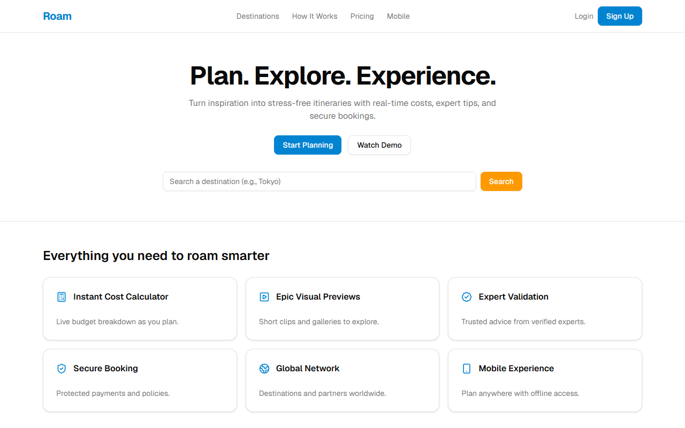
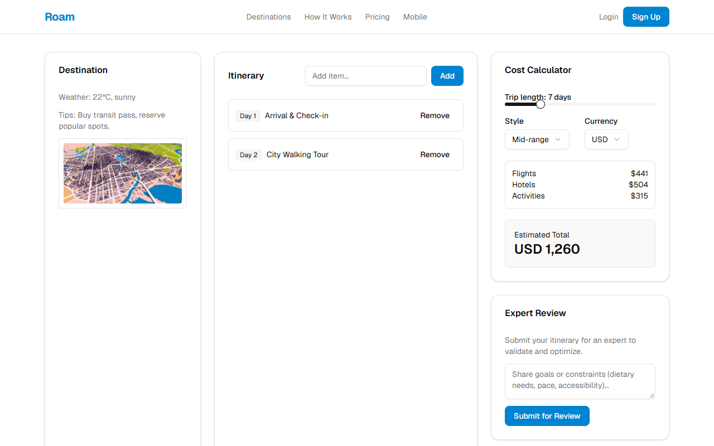

# Roam

**Plan. Explore. Experience.** A trip-planning and booking interface: browse destinations, build an itinerary, see the cost add up, and walk through checkout.

[](https://github.com/smadhu6364-beep/roam-travel/actions/workflows/ci.yml)
[](https://smadhu6364-beep.github.io/roam-travel/)


**Live demo:** https://smadhu6364-beep.github.io/roam-travel/



> **Status: frontend prototype.** Every page and component is built and interactive, but flight search, payments and accounts are not connected to a backend. There are no API routes. The site is exported as static HTML.

## Features

- Destination browsing with search and filters (budget, season, activity)
- Trip planner: itinerary builder, cost calculator and an "expert review" panel
- Booking flow: review, payment and confirmation screens
- User dashboard with bookings and profile pages
- Auth screens: login, signup, password reset
- Content pages: pricing, how it works, company, resources, legal, help and support
- Light and dark themes



## Tech stack

| Layer | Technology |
|---|---|
| Framework | Next.js 16 (App Router, static export), React 19, TypeScript |
| Styling | Tailwind CSS 4, tailwindcss-animate |
| UI components | Radix UI primitives, shadcn/ui |
| Forms and validation | React Hook Form, Zod |
| Charts | Recharts |
| Hosting | GitHub Pages via GitHub Actions |

## Quick start

Needs Node.js 20.9 or newer.

```bash
git clone https://github.com/smadhu6364-beep/roam-travel.git
cd roam-travel
npm install
npm run dev        # http://localhost:3000
```

Other scripts:

```bash
npm run typecheck  # tsc --noEmit
npm run build      # static export into out/
```

## Environment variables

None are needed to run the UI. `.env.example` lists placeholders for integrations that are not wired in yet:

- `AMADEUS_CLIENT_ID`, `AMADEUS_CLIENT_SECRET` (flight data)
- `DATABASE_URL`
- `STRIPE_SECRET_KEY`, `STRIPE_WEBHOOK_SECRET` (payments)
- `YOUTUBE_API_KEY` (optional video previews)
- `NEXT_PUBLIC_APP_URL`
- `NEXT_PUBLIC_BASE_PATH` (only when serving from a subfolder, as on GitHub Pages)

## Project structure

```
app/            routes (App Router): planner, destinations, booking, dashboard, auth, content pages
components/
  home/         landing page sections
  planner/      itinerary builder, cost calculator, expert review
  destinations/ filters
  site/         nav, footer, page shell
  ui/           shadcn/ui components
hooks/, lib/    shared helpers
public/         images
```

## Limitations

- All data is hard-coded sample data; nothing is saved.
- Login, signup and payment forms do not submit anywhere.
- Images are placeholders.

## A note on credentials

An earlier local copy had live Amadeus API credentials in a `roma.env.local` file that the original `.gitignore` did not exclude. That file was never pushed here, and `.gitignore` now excludes every `.env*` file except `.env.example`. If those credentials are still active, they should be rotated.
